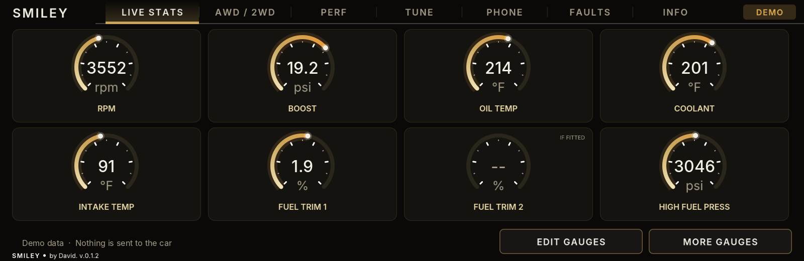
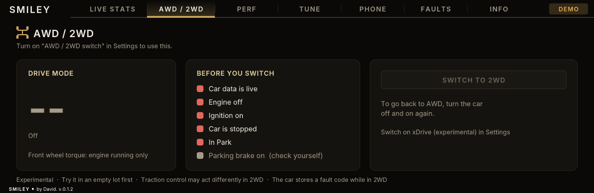
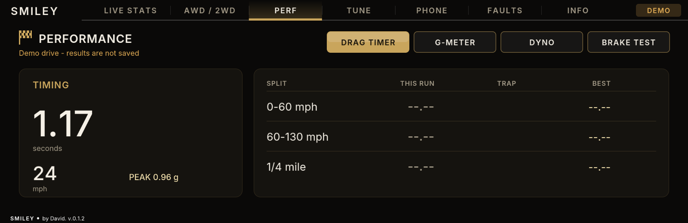
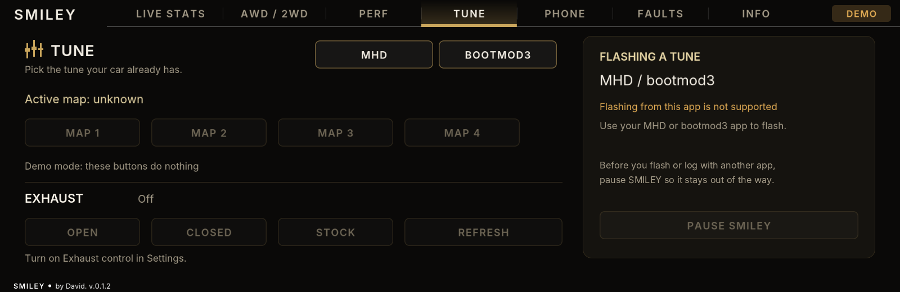
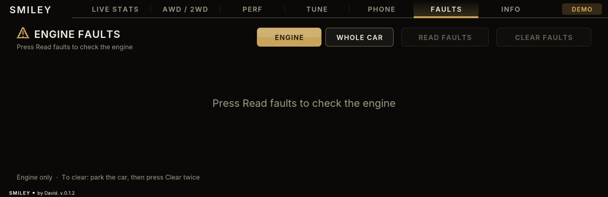
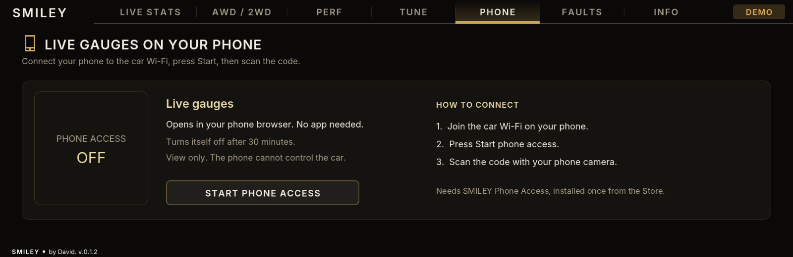
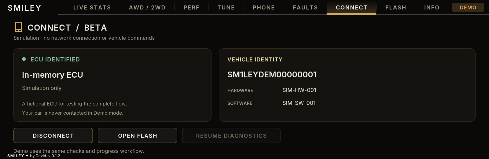
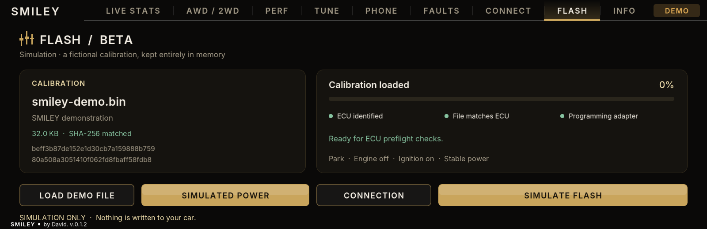
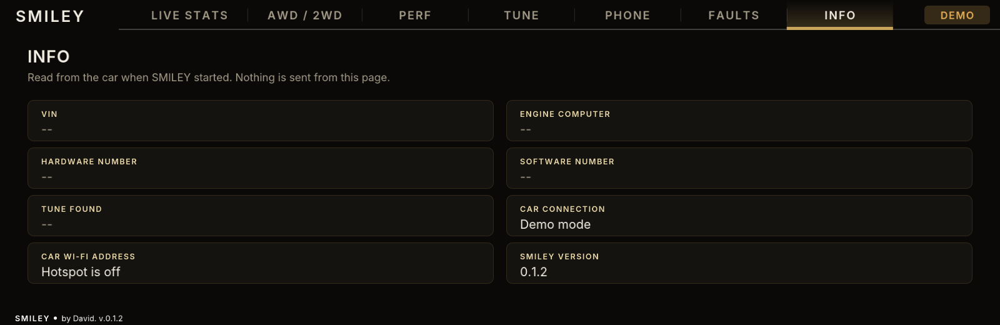
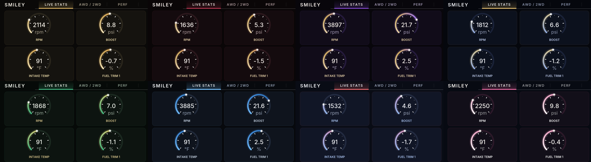

<div align="center">


# SMILEY

**Your BMW's engine, tune, faults and performance timers, on the car's own screen.**

An app for the iDrive 7 head unit (MGU) &nbsp;·&nbsp; Version 0.1.6 &nbsp;·&nbsp; by David Myat

[Take the tour](#the-tour) &nbsp;·&nbsp; [Themes](#nine-looks) &nbsp;·&nbsp; [Connect / Flash beta](#connect-and-flash-beta) &nbsp;·&nbsp; [Install](#install) &nbsp;·&nbsp; [Read this first](#read-this-first)



</div>

> **Early version.** SMILEY has run on one car so far, a 2021 G20 M340i xDrive.
> Everything else is checked on a computer simulation of the head unit.
> [Read this first](#read-this-first) before you install.

## The tour

Six tabs across the top of the screen in version 0.1.6: Live Stats, AWD / 2WD,
Perf, Tune, Faults and Info. **Phone, Connect and Flash are switched off for
now**; their sections below describe what they do when they return. The
screenshots come from the simulation, with demo data.

<table>
<tr>
<td width="55%"></td>
<td>

### Live Stats

Sixteen engine readings on two pages of round gauges: RPM, boost, oil,
coolant and intake temperature, fuel trims, fuel pressures, timing, lambda,
oil pressure, boost target, load, torque and misfires.

Press and hold a gauge to move it or swap it for another.

</td>
</tr>
<tr>
<td>

### AWD / 2WD

Switches xDrive off, so the car drives the rear wheels only, and shows what
the car reports back. A checklist tells you when it is safe to switch.

Experimental, and off until you turn it on in Settings.

</td>
<td width="55%"></td>
</tr>
<tr>
<td width="55%"></td>
<td>

### Perf

Four tools that only read: a drag timer (0-60, 60-130, quarter mile), a
G-meter, a dyno graph of power and torque after each pull, and a brake test.

</td>
</tr>
<tr>
<td>

### Tune

Switches between the maps of an MHD or bootmod3 tune that is already on the
car, and opens, closes or releases the exhaust flap.

It does not flash a tune. Pause SMILEY keeps it out of the way while your
tuning app does.

</td>
<td width="55%"></td>
</tr>
<tr>
<td width="55%"></td>
<td>

### Faults

Reads and clears fault codes for the engine or for every module in the car,
with a plain description of each code where the database has one.

Clearing needs the car in Park and two presses.

</td>
</tr>
<tr>
<td>

### Phone (switched off for now)

Live gauges in a phone browser over the car's Wi-Fi. View only: the phone
cannot control the car.

Needs the SMILEY Phone Access helper, listed under the same Store source.

</td>
<td width="55%"></td>
</tr>
<tr>
<td width="55%"></td>
<td>

### Connect (beta, switched off for now)

A dedicated DoIP connection for ECU identification, plus an offline demo ECU.
Requires a vehicle-specific connection setup for real diagnostics. A beta
warning appears before the controls each time you enter this tab.

</td>
</tr>
<tr>
<td>

### Flash (beta, switched off for now)

Calibration-file checks, matching the file to the ECU, two-step confirmation,
and acknowledged transfer progress. The full workflow runs against the demo ECU.

**Not tested on a car. Live ECU flashing stays locked:** no verified BMW
programming adapter is included. A separate warning appears every time you enter.

</td>
<td width="55%"></td>
</tr>
<tr>
<td width="55%"></td>
<td>

### Info

The car's VIN, the engine computer's type and numbers, the tune found, and
the app version. Read once when SMILEY starts.

</td>
</tr>
</table>

## Nine looks

Pick one under Settings → Theme. Eight are ready-made; the ninth is yours.
**Christmas** adds gently falling snow over every page.



| | | | |
|---|---|---|---|
| Noir & Champagne | Burgundy & Gold | Amethyst & Gold | Midnight & Gold |
| Racing Green | Motorsport | Spider Red & Blue | Christmas (snow) |
| **Custom** | | | |

**Custom** builds a theme from three choices in Settings: a main colour, a
second colour and a background. Twelve colours and four backgrounds give 576
combinations.

## Connect and Flash beta

> Both tabs are hidden in this version. The notes below apply when they are
> switched back on (`HIDDEN` in `apps/smiley/ui.js`).

This build merges Connect and Flash into the latest uploaded `smiley-MAIN`
source, preserving the car logo, all eight themes, custom colours and existing
features. The app version remains **0.1.2**. The new tabs follow the selected
theme and custom colours automatically.

To try them without contacting a car, turn **Demo data** on in Settings. Open
**Connect**, acknowledge the warning and select **Connect demo**. Open **Flash**,
acknowledge its warning, choose **Load demo file**, confirm **Simulated power**,
then press **Simulate flash** and **Confirm flash**. The demo uses fictional
ECU responses and writes nothing to the car.

These additions are experimental and have only been tested in simulation.
Connect is a DoIP client, not an MHD phone/Wi-Fi bridge. Live flashing requires
ECU-specific programming support that is not included in this build.
[Setup, limitations and test details](docs/CONNECT_FLASH.md).

When updating the GitHub source, use the contents of the extracted
`smiley-MAIN` folder as the repository root: `mgu-repo.json`, `apps`, `kit`,
`native` and the other existing files belong at the top level. Uploading only
the ZIP file does not replace the source code used by the Store. Because the
version is kept at 0.1.2, a version-based updater may require an explicit
reinstall/replacement rather than offering a newer version automatically.

## Install

**You need**

- A BMW with iDrive 7 (MGU head unit).
- Root SSH access to the head unit, and the
  [MGU Store](https://github.com/robertnisipeanu/mgu-store) installed on it.
- From the [idrive7-apps](https://github.com/cauliflowermossgrape/idrive7-apps)
  source in the Store: the GPU renderer (2.1.7 or newer) and the controller
  gate. The Store also needs its Python component, because it builds SMILEY on
  the head unit.
- For the Tune tab: an MHD or bootmod3 tune already flashed.

**From GitHub**

1. Connect the car to the internet (a phone hotspot works).
2. In the Store, open Settings and add the source `dmyat/smiley`.
3. Choose the `MAIN` branch.
4. Install SMILEY, and restart the head unit if the Store asks.

While this repository is private, the Store needs a GitHub access token to
read it.

**From a USB stick**

1. Download this repository and copy it to the stick as `mgu-repo/smiley/`, so
   that `mgu-repo/smiley/mgu-repo.json` exists.
2. Plug the stick into the car and open the Store's USB page.
3. Install SMILEY.

Keep the car parked and on stable power until the install finishes.

## Read this first

**On a first install, check it parked, in this order, and stop at the first
thing that looks wrong.**

1. Open the app and confirm Live Stats draws.
2. With the engine idling, compare RPM, coolant and oil temperature with the
   instrument cluster. Note any gauge that stays on dashes.
3. Open More gauges and check the same way. Lambda should be near 1.00 at warm
   idle.
4. On Faults, press Read faults, then Scan car. Both only read.
5. On AWD / 2WD, turn the switch on in Settings and check that the checklist
   matches the car, without pressing Switch to 2WD.
6. Only then try what sends commands: a map change, the exhaust, clearing
   faults, and last of all 2WD, in an empty lot.

**What to know**

- **AWD / 2WD is experimental.** Traction and stability control may behave
  differently in 2WD, and that was not measured. The car stores a fault code
  while xDrive is off.
- **Clearing faults erases them.** Read the codes first.
- **The dyno is an estimate** from the weight and drivetrain loss set in
  Settings, not a dyno reading.
- **The Phone tab needs a helper.** The head unit's firewall blocks incoming
  connections, and an app cannot change it. SMILEY Phone Access is a small
  service that runs as root and opens TCP port 8765 on the car's Wi-Fi only
  while the phone page is on. It has been tested against a pretend firewall
  only, not on a car.
- **Some readings are unconfirmed.** A gauge that shows dashes means the
  engine computer did not answer that reading.
- **Use the performance tools on closed roads only.**
- You install and use this at your own risk. It is independent community
  software and can affect your car and its warranty.

## For developers

```sh
python3 kit/tools/build.py --preview-only smiley   # stage the app without the BMW SDK
node tests/test-smiley.js                          # 45 integration checks
node tests/test-native-flow.js                     # the app on the head-unit stub
node tests/test-edit-gauges.js                     # press-and-hold gauge editing
node tests/test-phone-net.js                       # the phone access helper, against a pretend firewall
```

The app is `apps/smiley/`, the phone helper is `native/smiley-phone-net/`, and
`kit/` is the idrive7-apps kit the app is built on. How this build came
together is in [docs/BUILD_NOTES.md](docs/BUILD_NOTES.md).

## Licence

MIT licensed. See [LICENSE](LICENSE) and [NOTICE](NOTICE).

BMW, MHD and bootmod3 are their owners' marks. This is not their official
software, and no BMW SDK, tune files or licence keys are included.
