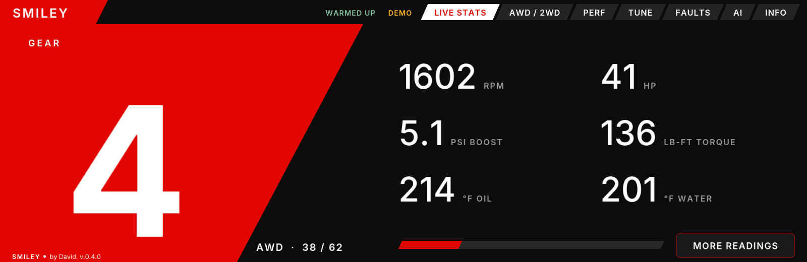
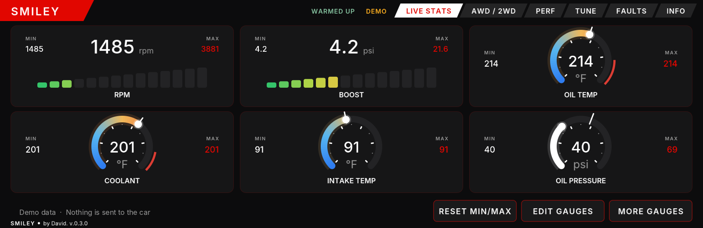
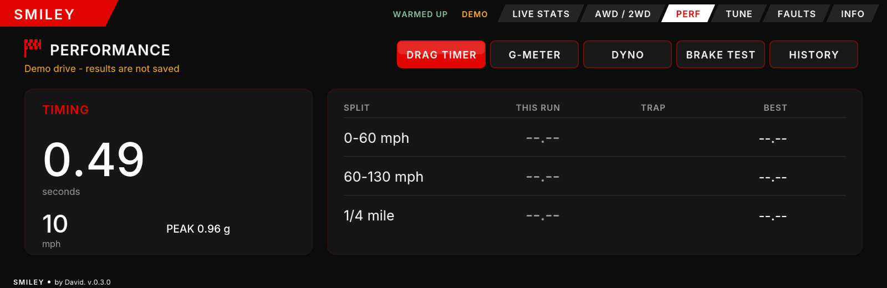
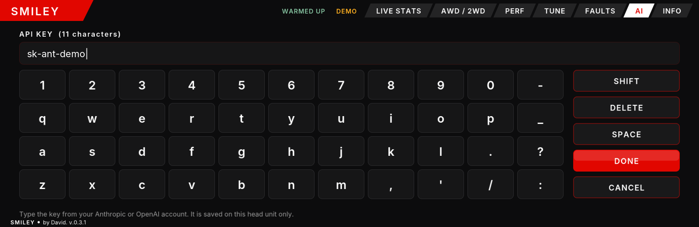
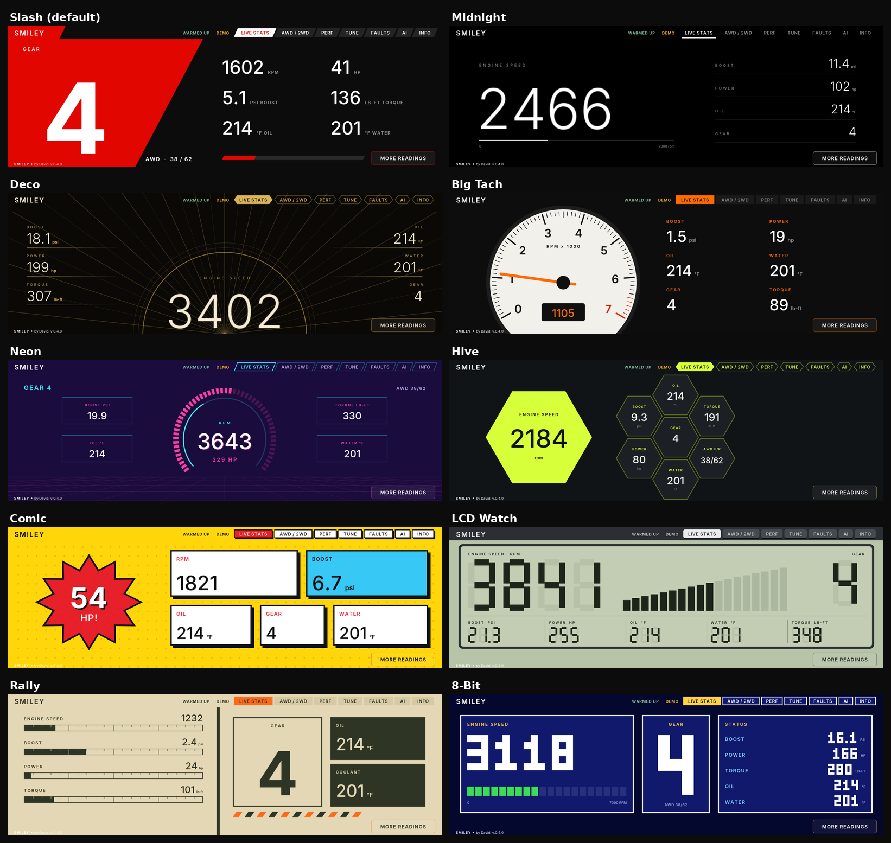

<div align="center">


# SMILEY

**Your BMW's engine, tune, faults and performance timers, on the car's own screen.**

An app for the iDrive 7 head unit (MGU) &nbsp;·&nbsp; Version 0.3.3 &nbsp;·&nbsp; by David Myat

[The tabs](#the-tabs) &nbsp;·&nbsp; [Themes](#themes) &nbsp;·&nbsp; [Install](#install) &nbsp;·&nbsp; [Read this first](#read-this-first)



</div>

> **Early version.** SMILEY has run on one car so far, a 2021 G20 M340i xDrive.
> Everything else is checked on a computer simulation of the head unit.
> [Read this first](#read-this-first) before you install.

## The tabs

Seven tabs: Live Stats, AWD / 2WD, Perf, Tune, Faults, AI and Info. Settings
is the last tab in the car's own strip. What changed in each version is in the
[release notes](CHANGELOG.md). The screenshots come from the simulation, with
demo data.

### Live Stats

Opens on the **Slash** screen at the top of this page: the gear, six readings
and a rev bar. The Layout button steps through five more layouts:

- **Six gauges**: two pages of gauges you choose from 17 readings. Press and
  hold a gauge to change what it shows.
- **Cockpit**, **Race dash** and **Graph view**: the same readings as a ring,
  rising bars, or 30-second lines.
- **Car view**: a top view of the car with each tyre's pressure and
  temperature, the xDrive torque split and the gearbox oil temperature.

Tap any reading to make it fill the page. The header shows a warm-up light,
the minutes until the oil is warm with the revs to keep under, and a turbo
cool-down countdown after hard driving.



### AWD / 2WD

Switches xDrive off so the car drives the rear wheels only, and shows what the
car reports back. Off until you turn on "AWD / 2WD switch" in Settings. In 2WD
the rear axle takes all of the torque: **no hard launches**.

### Perf

A drag timer (0-60, 60-130, quarter mile), a G-meter, a dyno graph after each
pull and a brake test. History keeps every run for 30 days.



### Tune

Switches between the maps of an MHD or bootmod3 tune already on the car, and
opens or closes the exhaust flap. It does not flash a tune.

### Faults

Reads and clears fault codes for the engine or the whole car, with a plain
description where the database has one. Clearing needs Park and two presses.

### AI

Ask an AI assistant about the car: four ready-made questions or your own. It
needs your own API key (Anthropic or OpenAI, billed to you by use) and
internet in the car. Send the key from your phone with the QR code, or type it
on the screen; it is saved on the head unit only. Each question goes out with
the live readings and the fault codes last read, never the VIN. Chat only: it
cannot run anything or change the car, and answers can be wrong.



### Info

The VIN, the engine computer's numbers, the tune found and the app version.

## Themes

Settings → Theme. **Slash** is the default. The others: Noir & Champagne,
Burgundy & Gold, Amethyst & Gold, Midnight & Gold, Racing Green, Motorsport,
Spider Red & Blue, Christmas Green and Christmas Red (both with falling snow),
and **Custom**, built from a main colour, a second colour and a background.



## Install

**You need**

- A BMW with iDrive 7 (MGU head unit).
- Root SSH access to the head unit, and the
  [MGU Store](https://github.com/robertnisipeanu/mgu-store) installed on it.
- From the [idrive7-apps](https://github.com/cauliflowermossgrape/idrive7-apps)
  source in the Store: the GPU renderer (2.1.7 or newer) and the controller
  gate. The Store also needs its Python component, because it builds SMILEY on
  the head unit.
- For the Tune tab: an MHD or bootmod3 tune already flashed.

**From GitHub**

1. Connect the car to the internet (a phone hotspot works).
2. In the Store, open Settings and add the source `dmyat/smiley`.
3. Choose the `MAIN` branch.
4. Install SMILEY, and restart the head unit if the Store asks.

While this repository is private, the Store needs a GitHub access token to
read it.

**From a USB stick**

1. Download this repository and copy it to the stick as `mgu-repo/smiley/`, so
   that `mgu-repo/smiley/mgu-repo.json` exists.
2. Plug the stick into the car and open the Store's USB page.
3. Install SMILEY.

Keep the car parked and on stable power until the install finishes.

## Read this first

**On a first install, check it parked, in this order, and stop at the first
thing that looks wrong.**

1. Open the app and confirm Live Stats draws.
2. With the engine idling, compare RPM, coolant and oil temperature with the
   instrument cluster. Note any gauge that stays on dashes.
3. Open More gauges and check the same way. Lambda should be near 1.00 at warm
   idle.
4. On Faults, press Read faults, then Scan car. Both only read.
5. Only then try what sends commands: a map change, the exhaust, clearing
   faults.

**What to know**

- **No hard launches in 2WD.** The rear driveshaft, axles and differential
  carry all of the torque, and a hard launch broke a driveshaft.
- **Clearing faults erases them.** Read the codes first.
- **The dyno is an estimate** from the weight and drivetrain loss set in
  Settings, not a dyno reading.
- **Sending the AI key from a phone needs a helper.** SMILEY Phone Access,
  from the same Store source, opens one port on the car's Wi-Fi while the
  pairing page is on. It has not been tested on a car; typing the key on the
  car screen needs nothing extra.
- **Some readings are unconfirmed.** A gauge that shows dashes means the
  engine computer did not answer that reading.
- **Use the performance tools on closed roads only.**
- You install and use this at your own risk. It is independent community
  software and can affect your car and its warranty.

## For developers

```sh
python3 kit/tools/build.py --preview-only smiley   # stage the app without the BMW SDK
node tests/test-smiley.js                          # 57 integration checks
node tests/test-native-flow.js                     # the app on the head-unit stub
node tests/test-edit-gauges.js                     # press-and-hold gauge editing
node tests/test-phone-net.js                       # the phone access helper, against a pretend firewall
```

The app is `apps/smiley/`, the phone helper is `native/smiley-phone-net/`, and
`kit/` is the idrive7-apps kit the app is built on. How this build came
together is in [docs/BUILD_NOTES.md](docs/BUILD_NOTES.md).

## Licence

MIT licensed. See [LICENSE](LICENSE) and [NOTICE](NOTICE).

BMW, MHD and bootmod3 are their owners' marks. This is not their official
software, and no BMW SDK, tune files or licence keys are included.
